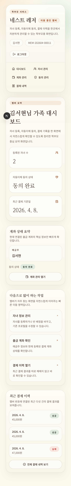

# 어린이집 수납 CRM 데모

효성CMS 자동이체 운영 시나리오를 기준으로 만든 포트폴리오용 데모 프로젝트입니다.  
기존 엑셀 수기 운영 방식에서 자주 발생하는 회원 관리, 자녀 소속 관리, 자동이체 처리, 미납 관리, 거래명세표 발행 흐름을 웹 기반으로 재구성했습니다.

## 프로젝트 개요

- 학부모용 모바일 웹과 관리자용 CRM 웹을 한 저장소에서 구현했습니다.
- 학부모는 자녀를 등록하고, 어린이집과 반을 연결하고, 자동이체 계좌와 동의 상태를 관리할 수 있습니다.
- 관리자는 회원 CRM, 배치 출금, 결과 조회, 미납 관리, 거래명세표 다운로드까지 한 흐름으로 운영할 수 있습니다.
- 실제 운영 납품본이 아니라, 도메인 이해도와 구현 역량을 보여주기 위한 실무형 포트폴리오 데모입니다.

## 핵심 기능

### 학부모용

- 회원가입 및 로그인
- 자녀 등록, 어린이집 검색, 반 연결
- 자동이체 계좌 등록 및 삭제
- 출금 동의 / 철회
- 결제 내역 조회

### 관리자용

- 회원 CRM 조회
- 회원번호 자동 생성
- 배치 출금 실행
- 출금 결과 조회
- 미납 회원 조회 및 필터링
- 거래명세표 엑셀 다운로드

## 포트폴리오 포인트

- 어린이집 운영 도메인에 맞춘 학부모 화면과 관리자 CRM을 분리 구성
- 계좌번호 AES-256 암호화 저장 및 마스킹 표시
- Supabase RLS와 제약 조건으로 회원/계좌/배치 흐름 보호
- Playwright, Vitest 기반의 회귀 테스트 포함
- 포트폴리오 제출용 스크린샷 세트 제공

## 기술 스택

- Frontend: Next.js 15, React 19, TypeScript
- Styling: Tailwind CSS, shadcn/ui
- Backend: Next.js Server Actions, Route Handlers
- Database: Supabase PostgreSQL
- Auth: Supabase Auth
- Deployment Target: Vercel

## 화면 미리보기

포트폴리오용 캡처 파일은 `./.portfolio-screenshots/` 에 정리되어 있습니다.

### 학부모 대시보드



### 회원 CRM


### 미납 관리


## 데이터 구조

주요 테이블은 아래와 같습니다.

- `cms_members`: 학부모 회원 정보
- `cms_bank_accounts`: 자동이체 계좌 정보
- `cms_children`: 자녀 정보
- `cms_childcare_centers`: 어린이집 정보
- `cms_childcare_classes`: 반 정보
- `cms_billing_batches`: 배치 실행 정보
- `cms_billing_results`: 배치 결과 정보

## 로컬 실행

### 1. 설치

```bash
npm install
```

### 2. 환경 변수 설정

`.env.local` 파일에 아래 값을 설정합니다.

```env
NEXT_PUBLIC_SUPABASE_URL=your_supabase_url
NEXT_PUBLIC_SUPABASE_ANON_KEY=your_anon_key
SUPABASE_SERVICE_ROLE_KEY=your_service_role_key
ACCOUNT_ENCRYPTION_KEY=your_64_char_hex_key
ADMIN_EMAIL=your_admin_email
```

### 3. 마이그레이션 반영

```bash
npx supabase db push
```

### 4. 개발 서버 실행

```bash
npm run dev
```

기본 주소: `http://127.0.0.1:3000`

## 테스트

```bash
npm run lint
npx vitest run
npx playwright test
```

이번 포트폴리오 정리 시 검증한 대표 테스트:

- 멤버 회귀 smoke
- 관리자 미납/엑셀 export smoke
- 자녀 등록/조회 관련 Vitest
- 관리자 CRM / 미납 화면 Vitest

## 참고 사항

- 이 프로젝트는 효성CMS 실운영 계약 환경을 직접 연결한 납품본이 아닙니다.
- 대신 자동이체 운영 시스템에서 중요한 사용자 흐름과 관리자 업무 흐름을 포트폴리오 수준으로 설계·구현·검증하는 데 집중했습니다.
- 실서비스 적용 시에는 효성CMS 실제 API 스펙, 운영 정책, 배포 환경, 모니터링 체계를 추가로 맞춰야 합니다.
