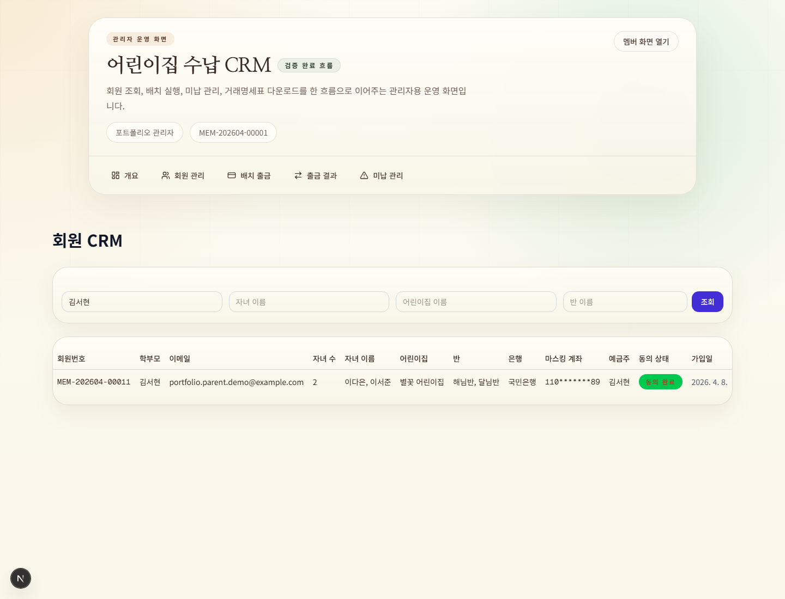
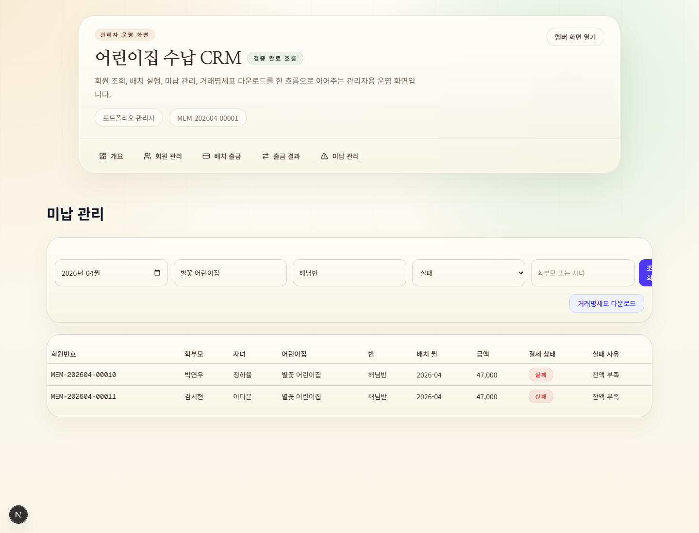
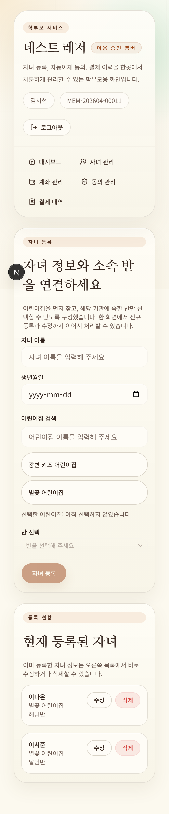
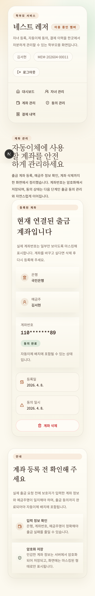

# 어린이집 수납 CRM 데모

어린이집 수납 자동이체를 학부모용 모바일 웹과 관리자용 CRM으로 나눠 구현한 Next.js 16 + Supabase 데모입니다.
계좌 등록 → 출금 동의 → 월별 배치 출금 → 결과·미납 조회 → 미납 명세표 엑셀까지 한 흐름으로 이어집니다.

> **실제 운영 납품본이 아닌 포트폴리오용 데모입니다.** 배포된 라이브 주소는 없습니다.
> CMS 자동이체 운영 시나리오를 가정했을 뿐, 실제 금융사나 자동이체 기관과 연동하지 않습니다.
> 출금은 금융망을 거치지 않고 서버에서 난수로 성공·실패를 정하는 모의 처리입니다. 화면의 어린이집·인물·계좌는 모두 가상 데이터입니다.

## 왜 만들었나

학부모 명단, 자녀의 어린이집·반, 출금 계좌와 동의 여부, 월별 출금 결과를 엑셀 시트로 따로 관리하는 운영을 가정했습니다.
이 방식에서는 계좌번호가 평문으로 파일에 남고, 같은 달 출금을 두 번 돌리는 실수를 막을 장치가 없으며, 미납자를 어린이집·반 단위로 뽑으려면 매번 시트를 손으로 맞춰야 합니다.
이 데모는 그 세 가지를 암호화 저장, DB 제약, 조건 조회와 엑셀 내보내기로 옮긴 것입니다.
실제 CMS 자동이체 API는 이용 계약이 있어야 쓸 수 있어, 출금 구간은 모의 처리로 대체했습니다.

## 무엇을 하는가

**학부모 (모바일 웹)**

- 이메일과 비밀번호로 가입·로그인합니다. 가입하면 회원번호(`MEM-YYYYMM-00001` 형식)가 붙은 회원 행이 생깁니다.
- 자녀를 등록하면서 어린이집을 검색해 고르고, 그 어린이집에 속한 반을 선택합니다. 수정과 삭제도 같은 화면에서 합니다.
- 출금 계좌(은행, 계좌번호, 예금주)를 한 개 등록하거나 삭제합니다.
- 출금 동의를 하거나 철회합니다. 동의한 계좌만 배치 출금 대상이 됩니다.
- 자신의 출금 내역을 전체·성공·실패로 나눠 봅니다.

**관리자 (CRM)**

- 회원 CRM: 학부모·자녀·어린이집·반·마스킹된 계좌·동의 상태를 한 표로 보고, 학부모·자녀·어린이집·반으로 좁혀 조회합니다.
- 배치 출금: 이번 달 배치를 실행합니다. 활성 스케줄 가운데 동의가 끝난 계좌만 대상이고, 같은 달은 한 번만 실행됩니다.
- 출금 결과: 배치별 성공·실패 건을 보고, 실패 건에서 미납 관리 화면으로 넘어갑니다.
- 미납 관리: 월·어린이집·반·상태·이름으로 조회합니다(기본값은 실패 건). 월·어린이집·반을 모두 지정하면 미납 명세표를 엑셀로 내려받습니다(화면의 버튼 이름은 "거래명세표 다운로드").

| | |
|---|---|
|  |  |
| 회원 CRM(학부모·자녀·어린이집·반·마스킹 계좌) | 미납 관리와 엑셀 내려받기 |

<details>
<summary>학부모 모바일 화면 2장</summary>

 

</details>

전체 캡처 9장은 [`.portfolio-screenshots/`](./.portfolio-screenshots/README.md)에 있습니다.

## 구조

```text
브라우저
 ├─ 학부모 화면  src/app/(member)   /dashboard /children /account /consent /payments
 │    Server Component(조회) + Server Action(쓰기)
 │    └─ createClient()        로그인 세션 쿠키 + anon 키 → RLS 적용, 본인 행만
 ├─ 관리자 화면  src/app/(admin)    /admin /admin/members /admin/billing /admin/results /admin/overdue
 │    requireAdmin() 통과 후 Server Component(조회)
 │    ├─ createServiceClient() 서비스 키 → RLS 우회, 전체 회원 조회
 │    ├─ POST /api/billing/run        배치 출금(모의) Route Handler
 │    └─ GET  /admin/overdue/export   미납 명세표 xlsx Route Handler
 └─ 로그인·가입  src/app/(auth)     브라우저용 Supabase 클라이언트로 Auth 호출

(가상의 외부 통지) ─ POST /api/webhook/cms   출금 결과 갱신, 서비스 키
```

- 인증은 Supabase Auth입니다. [`src/middleware.ts`](./src/middleware.ts)는 세션 쿠키 갱신만 하고, 접근 제어는 레이아웃과 페이지에서 `requireAuth()`·`requireAdmin()`으로 합니다.
- 서비스 키 클라이언트는 서버 코드에서만 만듭니다. 쓰는 곳은 관리자 페이지 3개(개요·회원·출금 결과), 미납 조회 함수, 배치 출금 라우트, 웹훅 라우트입니다.

주요 테이블([`supabase/migrations/`](./supabase/migrations))

```text
auth.users ─(가입 트리거, 같은 id)─ cms_members
cms_members 1 ── 1 cms_bank_accounts        계좌(암호문), 동의 상태. member_id 유일
cms_members 1 ── N cms_children N ── 1 cms_childcare_classes N ── 1 cms_childcare_centers
cms_members 1 ── N cms_billing_schedules    금액, 출금일, 활성 여부
cms_billing_batches 1 ── N cms_billing_results   회원·계좌별 출금 결과. batch_month 유일
```

## 설계 결정

1. **계좌번호는 암호문으로만 저장하고 화면에는 마스킹해 보여 줍니다.**
   엑셀 운영에서 평문으로 남던 값을 DB에 그대로 두지 않기 위해서입니다. AES-256-CBC에 매번 새 IV를 써서 `iv:암호문` 형식으로 저장하고, 키는 환경 변수로만 받습니다([`src/lib/crypto.ts`](./src/lib/crypto.ts)). 암호화는 계좌 등록 Server Action에서 합니다([`account/actions.ts`](./src/app/%28member%29/account/actions.ts)). 관리자 화면은 서버에서 복호화한 뒤 앞 3자리와 뒤 2자리만 남긴 값을 렌더링합니다. 학부모 본인 계좌 화면은 서버에서 복호화한 값을 화면 컴포넌트에 넘겨 마스킹해 표시합니다.

2. **학부모 쪽은 RLS로 본인 데이터만, 관리자 쪽은 관리자 확인 뒤 서비스 키로 조회합니다.**
   학부모 화면과 Server Action은 세션이 실린 클라이언트만 쓰고, 테이블마다 `auth.uid()`와 소유 컬럼을 비교하는 정책을 걸었습니다(마이그레이션 [001](./supabase/migrations/001_initial_schema.sql)·[002](./supabase/migrations/002_additional_rls_policies.sql)·[003](./supabase/migrations/003_fix_rls_and_constraints.sql)·[006](./supabase/migrations/006_parent_childcare_domain.sql)). 자녀 수정·삭제는 쿼리에도 `parent_member_id` 조건을 한 번 더 겁니다. RLS에는 관리자 역할이 없어서, 전체 회원을 봐야 하는 관리자 화면은 서비스 키를 씁니다. 그 대신 관리자 확인을 [`src/lib/admin-auth.ts`](./src/lib/admin-auth.ts) 한 곳에 모아 페이지와 라우트가 같은 함수를 거치게 했습니다.

3. **중복과 잘못된 상태는 애플리케이션 검사에 더해 DB 제약으로 막습니다.**
   배치 출금 라우트는 같은 달 배치가 있는지 먼저 확인하지만, 동시에 두 요청이 오면 둘 다 통과할 수 있습니다. 그래서 `batch_month`에 유일 제약을 두고, 라우트는 제약 위반(23505)을 "이미 있는 배치"로 응답합니다([`api/billing/run/route.ts`](./src/app/api/billing/run/route.ts), 마이그레이션 003). 회원당 계좌 한 개, 동의·배치·결과 상태 값, 금액(0 초과)과 출금일(1~28)도 같은 마이그레이션에서 제약으로 걸었습니다.

4. **회원번호와 회원 프로필은 DB 트리거가 만듭니다.**
   처음에는 행 수를 세어 다음 번호를 만들었는데, 이 방식은 RLS 아래에서 다른 회원 행이 보이지 않아 순번이 틀어지고 동시 가입에서 번호가 겹칠 수 있습니다. [004](./supabase/migrations/004_fix_member_no_generation.sql)에서 `security definer` 함수로 바꾸고, 월별 접두어 단위로 `pg_advisory_xact_lock`을 잡은 뒤 최대 번호 + 1을 쓰게 했습니다. 프로필 행은 `auth.users` 삽입 트리거가 만들므로([005](./supabase/migrations/005_create_member_profile_on_auth_signup.sql)) 가입 폼은 Auth 가입만 호출합니다.

5. **미납 화면과 엑셀은 같은 조회 함수를 씁니다.**
   화면에서 본 목록과 내려받은 파일이 달라지지 않도록, 둘 다 [`admin/overdue/data.ts`](./src/app/%28admin%29/admin/overdue/data.ts)의 `fetchOverdueRows`를 거칩니다. 조회의 기준은 출금 결과 한 건이고, 자녀가 여럿이면 이름·어린이집·반을 한 행에 모읍니다. 범위가 모호한 파일이 나가지 않도록 월·어린이집·반이 모두 있어야 내보내며, 빠지면 라우트가 400을 돌려줍니다([`export/route.ts`](./src/app/%28admin%29/admin/overdue/export/route.ts)).

## 검증

| 항목 | 명령 | 결과 |
|---|---|---|
| 단위 테스트 | `npm run test:unit` | 5개 파일 35건 통과 |
| 린트 | `npm run lint` | 통과 |
| 타입 검사 | `npx tsc --noEmit` | 오류 4건(테스트 파일 2개의 모의 객체 타입, 앱 코드에는 없음) |
| E2E | `npm run test:e2e` | 스펙 2개. 실제 Supabase 프로젝트가 있어야 실행되며 자동 실행 환경(CI)은 없음 |

단위 테스트는 Supabase와 관리자 확인을 모의 객체로 바꿔서 다음을 확인합니다.

- 자녀 Server Action(4건): 등록할 때 로그인한 회원 id가 보호자로 저장되는지, 수정·삭제 쿼리가 본인 행으로 한정되는지.
- 자녀 등록 폼(5건): 어린이집 검색으로 목록이 좁혀지는지, 어린이집을 고른 뒤에만 그 어린이집의 반이 선택되는지.
- 회원 CRM(7건): 필터가 있을 때만 관계 조인이 `!inner`로 바뀌는지, 학부모·자녀·어린이집·반·계좌가 한 행에 나오는지.
- 미납 조회(11건): 기본 상태가 실패인지, 출금 결과 한 건이 한 행으로 유지되는지, 범위가 갖춰지기 전에는 내보내기가 막히는지.
- 엑셀 내보내기 라우트(8건): 미로그인 401, 비관리자 403, 범위 누락 400, 열 순서와 파일명, xlsx 첨부 응답.

배치 출금 라우트, 웹훅, 암호화 모듈, 계좌·동의 Server Action에는 단위 테스트가 없습니다. RLS 정책도 실제 DB에서 돌려 보는 자동 테스트는 없습니다.
E2E 스펙 2개([`tests/`](./tests))는 실제 Supabase 프로젝트에서 로그인 → 학부모 화면 순회 → 자녀 등록 → 관리자 필터, 그리고 출금 결과 → 미납 조회 → 엑셀 다운로드 파일명까지를 확인하도록 작성되어 있습니다.

## 기술 스택

| 구분 | 내용 |
|---|---|
| 프레임워크 | Next.js 16.2.2(App Router, Server Action, Route Handler), React 19.2.4, TypeScript 5 |
| 화면 | Tailwind CSS 4, shadcn/ui(Base UI), lucide-react |
| 데이터·인증 | Supabase(PostgreSQL, Auth, RLS), `@supabase/ssr` |
| 암호화·엑셀 | Node.js `crypto`(AES-256-CBC), ExcelJS |
| 테스트 | Vitest + Testing Library(jsdom), Playwright, ESLint 9 |

## 로컬 실행

Node.js 20.9 이상과 Supabase 프로젝트 하나가 필요합니다.

1. 의존성 설치: `npm install`
2. `.env.local`에 아래 값을 넣습니다(이름만 적습니다. 파일은 저장소에 올라가지 않습니다).
   - `NEXT_PUBLIC_SUPABASE_URL`, `NEXT_PUBLIC_SUPABASE_ANON_KEY`
   - `SUPABASE_SERVICE_ROLE_KEY`: 서버 전용
   - `ACCOUNT_ENCRYPTION_KEY`: 32바이트를 hex로 적은 64자
   - `ADMIN_EMAIL`: 관리자로 쓸 계정의 이메일
3. 마이그레이션 반영: `npx supabase link` 후 `npx supabase db push`. 어린이집 2곳과 반 3개가 예시 데이터로 들어갑니다.
4. 실행: `npm run dev` → `http://localhost:3000`. 가입한 뒤 `ADMIN_EMAIL`과 같은 이메일로 로그인하면 `/admin`에 들어갈 수 있습니다.

E2E는 `.env.local`의 Supabase 프로젝트에 테스트 계정과 데이터를 직접 만들고, `ADMIN_EMAIL` 계정의 비밀번호도 테스트용 값으로 바꿉니다. 데모 전용 프로젝트에서만 실행하세요.

## 알려진 제한

- **출금은 모의 처리입니다.** 건마다 난수로 85%는 성공, 나머지는 네 가지 사유 중 하나로 실패 처리합니다. 결과가 요청 안에서 바로 확정되므로, 앱 흐름에서 웹훅이 호출되는 일은 없습니다.
- **웹훅에 서명 검증과 인증이 없습니다.** `POST /api/webhook/cms`는 가상의 결과 통지를 받는 데모용 엔드포인트이고, 결과 id를 아는 누구나 상태를 바꿀 수 있습니다. 이 상태로 공개 배포하면 안 됩니다.
- **관리자 판정은 환경 변수의 이메일 한 개와 비교하는 방식입니다.** 역할 테이블이나 관리자 여러 명은 지원하지 않습니다.
- **출금 스케줄을 등록하는 화면이 없습니다.** 배치는 `cms_billing_schedules`의 활성 행을 읽는데, 앱에는 이 행을 만드는 코드가 없어 SQL로 직접 넣어야 대상이 생깁니다. 출금일 값은 저장만 되고 배치에서 쓰지 않습니다.
- **배치는 관리자가 버튼으로 실행합니다.** 스케줄러는 없습니다. 결과를 한 건씩 넣으며 트랜잭션으로 묶지 않아, 한 건의 저장이 실패하면 그 건만 빠진 채 완료 처리됩니다. 요청이 도중에 끊기면 그 달 배치가 처리 중 상태로 남아 같은 달을 다시 실행할 수 없습니다.
- **암호화는 인증 태그가 없는 CBC 방식입니다.** 암호문 변조를 검출하지 못하고, 키 교체 절차도 없습니다.
- **타입 검사 오류 4건이 남아 있습니다.** 테스트 파일 2개의 모의 객체 타입 문제이며 테스트 실행에는 영향이 없습니다.
- **CI가 없습니다.** 단위 테스트와 린트는 로컬에서 실행하고, E2E는 Supabase 프로젝트를 연결해 수동으로 실행합니다.
